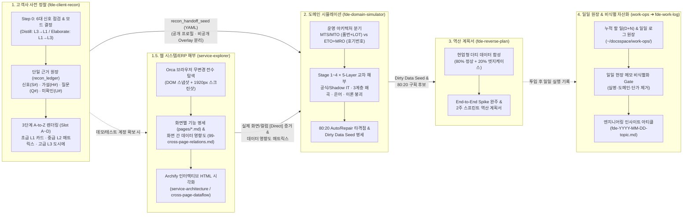

# fde-skills

현장 배치 엔지니어(Forward Deployed Engineer, FDE)가 **고객사 사전 공개 정찰(`fde-client-recon`) ➔ 실물 웹 시스템/ERP 무변경 전수 해부(`service-explorer`) ➔ 낯선 도메인 시뮬레이션(`fde-domain-simulator`) ➔ 더티 데이터 Spike 기반 역산 계획서(`fde-reverse-plan`) ➔ 일일 업무 원장 관리(`work-ops`) 및 비식별 기술 자산 변환(`fde-work-log`)**까지 일관되게 수행할 수 있도록 설계된 멀티 에이전트 스킬 모음입니다.

---

## 주요 기능 (Key Features)

### A. FDE 코어 파이프라인 스킬 (5종)
- **양방향 3단계 A-to-Z 고객사 사전 정찰 (`fde-client-recon`)**: 고객사 URL이나 회사명만으로 공개 신호(웹 메뉴·JSON-LD·카탈로그 스펙·채용 공고·인증/수출·시각 포렌식)를 해독해 운영 아키텍처(`MTS/ATO/MTO/ETO` + `MRO` 보조축)를 판별하고, 단일 근거 원장(`recon_ledger`)으로부터 **초급(`L1`) ↔ 중급(`L2`) ↔ 고급(`L3`)** 리포트와 공개 안전 핸드오프 시드(`recon_handoff_seed`)를 생성합니다.
- **실물 웹 서비스/ERP 무변경 전수 탐색 및 데이터 영향도 매핑 (`service-explorer`)**: Orca 내장 브라우저(`orca` CLI)와 로컬 자격증명(`credentials.json`)을 사용해 상태 변경 액션 없이 모든 화면의 DOM 스냅샷과 1920px 데스크톱 레이아웃 스크린샷(`set viewport 0 0` + CSS `zoom`)을 수집하고, 화면별 기능 명세(`pages/*.md`), **화면 간 데이터 생성➔소비 영향도(`99-cross-page-relations.md`)**, **Archify 인터랙티브 HTML 다이어그램**을 도출합니다.
- **Stage 1~4 × 5-Layer 도메인 시뮬레이션 (`fde-domain-simulator`)**: 고객사 원본 데이터를 받기 전에 공식 전산(ERP/MES/PLM)과 야전 장부(Shadow IT: 엑셀·메신저·수기 도면)의 괴리, 3대 계층(사장님·중간관리자·현장/A/S 실무자) 인센티브 왜곡, 스키마 용어 vs 현장 은어, 정통 운영이론 붕괴 지점을 교차 해부합니다.
- **더티 데이터 Spike 우선 역산 계획서 (`fde-reverse-plan`)**: 80% 정상 + 20% 현업 엣지케이스 샘플 데이터를 먼저 합성해 End-to-End로 한 판(Spike)을 완주한 뒤 **80% Auto Zone / 20% Repair Admin** 구획과 2주 스프린트 로드맵을 역산합니다.
- **야전 업무일지 비식별 인사이트 변환 (`fde-work-log`)**: `work-ops`로 기록한 일일 현장 메모에서 고객사 기밀과 고유명사를 엄격히 제거(De-identification Gate)하고 재사용 가능한 엔지니어링 아티클로 변환합니다.

### B. FDE 운영 원장 & 시각화 표준 스킬 (2종)
- **개인 업무 원장(SSOT) & D+N 할 일 관리 (`work-ops`)**: 작업 공간에 무관하게 `~/docsspace/work-ops/00_TODO.md`를 유일한 원장으로 삼아 오래된 순(`D+N`)으로 미완료 할 일을 브리핑하고, `#ai` 태스크를 승인 후 별도 세션으로 위임하며, 완료 작업 로그 및 일일 회고를 `~/docsspace/work-ops/01_Daily_Logs/YYYY-MM-DD.md`에 누적합니다.
- **응답 다이어그램 표준 렌더링 (`diagram-renderer`)**: 아키텍처·프로세스·데이터 흐름 설명 시 80~88열 폭 및 한/영(CJK) 정렬이 보정된 유니코드 ASCII 박스 다이어그램을 기본 렌더링하고, 명시적 요청 시 Mermaid 다이어그램으로 출력합니다.

---

## 아키텍처 및 파이프라인 (Architecture)



---

## 시작하기 및 설치 (Getting Started)

### 필요 환경 (Prerequisites)

- Bash 호환 셸 (`zsh`, `bash`)
- `SKILL.md` 규격을 지원하는 AI 코딩 에이전트 (`~/.agents/skills/`, `~/.claude/skills/`, `~/.gemini/config/skills/` 경로 참조)
- `service-explorer` 실행 시 Orca 내장 브라우저 (`orca` CLI) 및 Archify (`~/.agents/skills/archify`, Node.js)

### 설치 및 심볼릭 링크 일괄 등록

저장소를 클론한 뒤 [`scripts/install.sh`](scripts/install.sh)를 실행하면:
1. `~/.agents/skills/`, `~/.claude/skills/`, `~/.gemini/config/skills/` 3곳 모두에 스킬 심볼릭 링크가 자동 연결됩니다.
2. `skills/service-explorer/credentials.json`(`chmod 600`, Git 추적 제외)과 `~/docsspace/work-ops/` 원장 디렉토리가 자동 초기화됩니다.

```bash
git clone https://github.com/Dae-Jeong/fde-skills.git ~/personalspace/fde-skills
cd ~/personalspace/fde-skills
./scripts/install.sh
```

---

## 프로젝트 구조 (Project Structure)

```text
fde-skills/
├── .gitignore                        # 로컬 자격증명(**/credentials.json) 및 OS 임시파일 커밋 차단
├── AGENTS.md                         # 저장소/볼트 이원화 구조 및 4-Part 스킬 작성·보안 규칙
├── README.md                         # 프로젝트 개요 및 7종 스킬 파이프라인 가이드
├── scripts/
│   └── install.sh                    # ~/.agents, ~/.claude, ~/.gemini 심볼릭 링크 및 work-ops 원장 초기화
└── skills/
    ├── fde-client-recon/
    │   └── SKILL.md                  # Stage 1: 양방향 3단계(L1↔L2↔L3) OSINT 고객사 사전 정찰
    ├── service-explorer/
    │   ├── SKILL.md                  # Stage 1.5: Orca 브라우저 기반 웹 서비스/ERP 무변경 전수 탐색
    │   ├── credentials.example.json  # 로컬 자격증명 스키마 예시 (실제 credentials.json은 Git 제외)
    │   └── references/
    │       └── output_templates.md   # 사이트맵·페이지 명세·화면 간 데이터 영향도 리포트 템플릿
    ├── fde-domain-simulator/
    │   ├── SKILL.md                  # Stage 2: Stage 1~4 × 5-Layer 도메인 시뮬레이션
    │   └── examples/
    │       ├── manufacturing-domain-simulation.html
    │       └── manufacturing-domain-simulation.pdf
    ├── fde-reverse-plan/
    │   └── SKILL.md                  # Stage 3: 더티 데이터 Spike 기반 역산 계획서 작성
    ├── fde-work-log/
    │   └── SKILL.md                  # Stage 4: 일일 야전 메모 비식별화 및 기술 블로그 변환
    ├── work-ops/
    │   └── SKILL.md                  # Ops: ~/docsspace/work-ops/ 누적 할 일(D+N) 및 일일 작업 원장 관리
    └── diagram-renderer/
        └── SKILL.md                  # Util: 한/영 폭 정렬 안전 ASCII 박스 다이어그램 & Mermaid 렌더링
```

---

## 스킬별 상세 가이드 및 링크 (Skills Guide)

| 구분 | 스킬 | 핵심 메커니즘 | 산출물 및 예시 |
| :--- | :--- | :--- | :--- |
| **Stage 1** | [`fde-client-recon`](skills/fde-client-recon/SKILL.md) | • **Step 0 모드 선택**: `Distill`(`L3➔L2➔L1`) vs `Elaborate`(`L1 v0➔L2➔L3➔L1 v1`) 및 `L3-pending` 게이트<br>• **고정 슬롯 A~D**: 정체/아키텍처 ➔ 4단계 흐름/관리키 ➔ 3계층 고통/반증조건 ➔ 킬러 질문/타격점<br>• **아키텍처 판별**: 반복 양산형(`MTS/MTO`) vs 수주 설계형(`ETO` + `ATO/MRO` 보조축) | • `L1` 30초 카드 / `L2` 미팅 시트 / `L3` 풀스펙 도시에<br>• 단일 근거 원장(`recon_ledger`)<br>• 공개용 `recon_handoff_seed` (YAML) |
| **Stage 1.5** | [`service-explorer`](skills/service-explorer/SKILL.md) | • **무변경(Navigation-Only) 전수 탐색**: GNB/LNB 사이트맵 및 커버리지 To-Do 체크리스트<br>• **하이브리드 분석**: DOM 스냅샷 + 1920px 데스크톱 레이아웃 스크린샷(`set viewport 0 0` + CSS `zoom`)<br>• **데이터 리니지 역추적**: 화면 A 생성/수정 엔티티 ➔ 화면 B/C/D 드롭다운·컬럼·KPI 파급 효과 매핑 | • `00-sitemap-and-todo.md`<br>• `pages/<NN>-<slug>.md` & `screenshots/*.jpg`<br>• `99-cross-page-relations.md` & Archify HTML 시각화 |
| **Stage 2** | [`fde-domain-simulator`](skills/fde-domain-simulator/SKILL.md) | • **가로축 Stage 1~4 × 세로축 5-Layer** 20칸 매트릭스 해부<br>• **셀 출처 3분류**: `recon_evidence` / `recon_hypothesis` / `simulator_assumption`<br>• **이론 vs 현실 대조**: OEE·MRP·SPC (MTS) vs PERT/CPM·EVM·형상관리 (ETO) | • Stage × Layer 매트릭스 및 페르소나 롤플레잉<br>• 2계층 용어 사전 (스키마 용어 vs 현장 은어)<br>• [제조업 도메인 시뮬레이션 (HTML)](skills/fde-domain-simulator/examples/manufacturing-domain-simulation.html) / [PDF](skills/fde-domain-simulator/examples/manufacturing-domain-simulation.pdf) |
| **Stage 3** | [`fde-reverse-plan`](skills/fde-reverse-plan/SKILL.md) | • **R1(As-Is) ➔ R2(To-Be)** 문제 정의 및 현업 숨은 규약 해독<br>• **80% 정상 + 20% 엣지케이스** 합성 데이터 기반 End-to-End Spike 실행<br>• **80% Auto Zone / 20% Repair Admin** 실현 가능성 구획 | • 합성 더티 데이터셋 및 Spike 실행 결과<br>• 80:20 자동화/수리 어드민 설계서<br>• 2주 스프린트 실행 로드맵 |
| **Stage 4** | [`fde-work-log`](skills/fde-work-log/SKILL.md) | • **De-identification Gate**: 고객사명·내부 시스템명·실명·민감 단가 원천 치환<br>• 현업 관찰(Observation) ➔ 숨은 규약(Convention) ➔ 엔지니어링 판단(Decision) 구조화 | • 비식별 기술 블로그 포스트 초안 (`fde-YYYY-MM-DD-<topic>.md`) |
| **Ops** | [`work-ops`](skills/work-ops/SKILL.md) | • **단일 원장(`~/docsspace/work-ops/`)**: 전 워크스페이스 공통 `00_TODO.md` 및 `01_Daily_Logs/YYYY-MM-DD.md`<br>• **오래된 순(`D+N`) 정렬 & `#ai` 위임**: 경과일 기준 정렬 브리핑 및 승인 시 별도 에이전트 세션 실행 | • `~/docsspace/work-ops/00_TODO.md`<br>• `~/docsspace/work-ops/01_Daily_Logs/YYYY-MM-DD.md` |
| **Util** | [`diagram-renderer`](skills/diagram-renderer/SKILL.md) | • **유니코드 박스 다이어그램 기본값**: 80~88열 제한 및 한/영(CJK) 혼합 폭 깨짐 방지 레이아웃<br>• **온디맨드 Mermaid**: 명시적 요청 또는 아티팩트 문서 내 문법 안전(`""` 인용) 렌더링 | • 인라인 ASCII 아키텍처/데이터흐름 다이어그램 |

---

## 보안 및 비식별화 원칙 (Security & De-identification Policy)

이 저장소는 공개 GitHub 저장소(`https://github.com/Dae-Jeong/fde-skills`)이므로 다음 보안 원칙을 엄격히 적용합니다.

1. **실명·고유명사·자격증명 커밋 금지**: 실제 고객사 법인명, 도메인 URL, 대표자/담당자 실명, 고유 모델 번호, 실제 원본 데이터, 그리고 `service-explorer`의 실제 로그인 정보(`credentials.json`)는 절대 커밋하지 않습니다.
2. **비식별 아키텍처 프로필 사용**: 모든 예시는 `"수주 설계형 대형 프레스/설비 제조사(가상, ETO)"`, `"반복 양산형 부품 제조사(가상, MTS/MTO)"` 형태의 일반화된 아키텍처 프로필로만 기술합니다.
3. **공개 Seed와 비공개 Vault Overlay 분리**: 실제 고객사 정찰 시 민감 식별 맥락과 실제 서비스 탐색 산출물은 로컬 비공개 볼트(`~/docsspace/<project>/`)에만 보관하고, 공개 저장소에는 비식별 `recon_handoff_seed`와 범용 스킬 규격만 커밋합니다.
