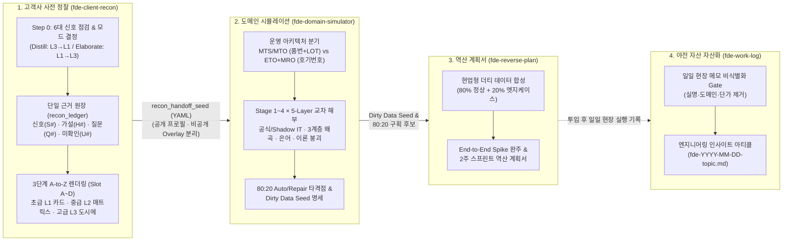

# fde-skills

현장 배치 엔지니어(Forward Deployed Engineer, FDE)가 고객사 첫 미팅 준비부터 낯선 도메인 시뮬레이션, 더티 데이터 Spike 기반 역산 계획서 작성, 일일 야전 업무일지의 비식별 기술 자산 변환까지 일관되게 수행할 수 있도록 설계된 AI 에이전트 스킬 모음입니다.

---

## 주요 기능 (Key Features)

- **양방향 3단계 A-to-Z 고객사 사전 정찰 (`fde-client-recon`)**: 고객사 URL이나 회사명만으로 공개 신호(웹 메뉴·JSON-LD·카탈로그 스펙·채용 공고·인증/수출·시각 포렌식)를 해독해 운영 아키텍처(`MTS/ATO/MTO/ETO` + `MRO` 보조축)를 판별하고, 단일 근거 원장(`recon_ledger`)으로부터 **초급(`L1`) ↔ 중급(`L2`) ↔ 고급(`L3`)** 3단계 해상도의 정찰 리포트와 공개 안전 핸드오프 시드(`recon_handoff_seed`)를 생성합니다.
- **Stage 1~4 × 5-Layer 도메인 시뮬레이션 (`fde-domain-simulator`)**: 고객사 원본 데이터를 받기 전에 공식 전산(ERP/MES/PLM)과 야전 장부(Shadow IT: 엑셀·메신저·수기 도면)의 괴리, 3대 계층(사장님·중간관리자·현장/A/S 실무자) 인센티브 왜곡, 스키마 용어 vs 현장 은어, 정통 운영이론 붕괴 지점을 교차 해부합니다.
- **더티 데이터 Spike 우선 역산 계획서 (`fde-reverse-plan`)**: 빈 종이에서 추상적인 계획서를 쓰는 대신, 80% 정상 + 20% 현업 엣지케이스 샘플 데이터를 먼저 합성해 End-to-End로 한 판(Spike)을 완주한 뒤 **80% Auto Zone / 20% Repair Admin** 구획과 2주 스프린트 로드맵을 역산합니다.
- **야전 업무일지 비식별 인사이트 변환 (`fde-work-log`)**: 현장에서 거칠게 기록한 일일 메모에서 고객사 기밀과 고유명사를 엄격히 제거(De-identification Gate)하고 재사용 가능한 엔지니어링 아티클로 변환합니다.

---

## 아키텍처 및 파이프라인 (Architecture)



---

## 시작하기 및 설치 (Getting Started)

### 필요 환경 (Prerequisites)

- Bash 호환 셸 (`zsh`, `bash`)
- `SKILL.md` 규격을 지원하는 AI 코딩 에이전트 (`~/.agents/skills/` 또는 `~/.claude/skills/` 경로 참조)
- *(선택)* 시각화 리포트(`HTML ➔ A4 PDF`) 렌더링 시 Google Chrome Headless 환경

### 설치 및 심볼릭 링크 등록

저장소를 클론한 뒤 [`scripts/install.sh`](scripts/install.sh)를 실행하면 `~/.agents/skills/`와 `~/.claude/skills/` 아래에 각 스킬 디렉토리가 심볼릭 링크로 자동 등록됩니다.

```bash
git clone https://github.com/Dae-Jeong/fde-skills.git
cd fde-skills
./scripts/install.sh
```

---

## 프로젝트 구조 (Project Structure)

```text
fde-skills/
├── AGENTS.md                         # 저장소 구조 및 비식별화 보안 규칙
├── README.md                         # 프로젝트 개요 및 파이프라인 가이드
├── scripts/
│   └── install.sh                    # ~/.agents/skills 및 ~/.claude/skills 심볼릭 링크 설치 스크립트
└── skills/
    ├── fde-client-recon/
    │   └── SKILL.md                  # 1단계: 양방향 3단계(L1↔L2↔L3) OSINT 고객사 사전 정찰 스킬
    ├── fde-domain-simulator/
    │   ├── SKILL.md                  # 2단계: Stage 1~4 × 5-Layer 도메인 시뮬레이션 스킬
    │   └── examples/
    │       ├── manufacturing-domain-simulation.html
    │       └── manufacturing-domain-simulation.pdf
    ├── fde-reverse-plan/
    │   └── SKILL.md                  # 3단계: 더티 데이터 Spike 기반 역산 계획서 작성 스킬
    └── fde-work-log/
        └── SKILL.md                  # 4단계: 일일 야전 메모 비식별화 및 기술 블로그 변환 스킬
```

---

## 스킬별 상세 가이드 및 링크 (Skills Guide)

| 단계 | 스킬 | 핵심 메커니즘 | 산출물 및 예시 |
| :--- | :--- | :--- | :--- |
| **Stage 1** | [`fde-client-recon`](skills/fde-client-recon/SKILL.md) | • **Step 0 모드 선택**: `Distill`(`L3➔L2➔L1`) vs `Elaborate`(`L1 v0➔L2➔L3➔L1 v1`) 및 `L3-pending` 환각 게이트<br>• **고정 슬롯 A~D**: 정체/아키텍처 ➔ 4단계 흐름/관리키 ➔ 3계층 고통/반증조건 ➔ 킬러 질문/타격점<br>• **아키텍처 판별**: 반복 양산형(`MTS/MTO`) vs 수주 설계형(`ETO` + `ATO/MRO` 보조축) | • `L1` 30초 카드 / `L2` 미팅 시트 / `L3` 풀스펙 도시에<br>• 단일 근거 원장(`recon_ledger`)<br>• 공개용 `recon_handoff_seed` (YAML) |
| **Stage 2** | [`fde-domain-simulator`](skills/fde-domain-simulator/SKILL.md) | • **가로축 Stage 1~4 × 세로축 5-Layer** 20칸 매트릭스 해부<br>• **셀 출처 3분류**: `recon_evidence` / `recon_hypothesis` / `simulator_assumption`<br>• **이론 vs 현실 대조**: OEE·MRP·SPC (MTS) vs PERT/CPM·EVM·형상관리 (ETO) | • Stage × Layer 매트릭스 및 페르소나 롤플레잉<br>• 2계층 용어 사전 (스키마 용어 vs 현장 은어)<br>• [제조업 도메인 시뮬레이션 (HTML)](skills/fde-domain-simulator/examples/manufacturing-domain-simulation.html) / [PDF](skills/fde-domain-simulator/examples/manufacturing-domain-simulation.pdf) |
| **Stage 3** | [`fde-reverse-plan`](skills/fde-reverse-plan/SKILL.md) | • **R1(As-Is) ➔ R2(To-Be)** 문제 정의 및 현업 숨은 규약 해독<br>• **80% 정상 + 20% 엣지케이스** 합성 데이터 기반 End-to-End Spike 실행<br>• **80% Auto Zone / 20% Repair Admin** 실현 가능성 구획 | • 합성 더티 데이터셋 및 Spike 실행 결과<br>• 80:20 자동화/수리 어드민 설계서<br>• 2주 스프린트 실행 로드맵 |
| **Stage 4** | [`fde-work-log`](skills/fde-work-log/SKILL.md) | • **De-identification Gate**: 고객사명·내부 시스템명·실명·민감 단가 원천 치환<br>• 현업 관찰(Observation) ➔ 숨은 규약(Convention) ➔ 엔지니어링 판단(Decision) 구조화 | • 비식별 기술 블로그 포스트 초안 (`fde-YYYY-MM-DD-<topic>.md`) |

---

## 보안 및 비식별화 원칙 (Security & De-identification Policy)

이 저장소는 공개 GitHub 저장소(`https://github.com/Dae-Jeong/fde-skills`)이므로 다음 보안 원칙을 엄격히 적용합니다.

1. **실명 및 고유명사 커밋 금지**: 실제 고객사 법인명, 도메인 URL, 대표자/담당자 실명, 고유 모델 번호, 실제 원본 데이터는 스킬 본문과 예시 파일에 절대 포함하지 않습니다.
2. **비식별 아키텍처 프로필 사용**: 모든 예시는 `"수주 설계형 대형 프레스/설비 제조사(가상, ETO)"`, `"반복 양산형 부품 제조사(가상, MTS/MTO)"` 형태의 일반화된 아키텍처 프로필로만 기술합니다.
3. **공개 Seed와 비공개 Overlay 분리**: 실제 고객사 정찰 시 민감 식별 맥락은 로컬 비공개 볼트 전용 `recon_private_overlay`에만 보관하고, 시뮬레이터와 공개 문서에는 비식별 `recon_handoff_seed`만 전달합니다.
